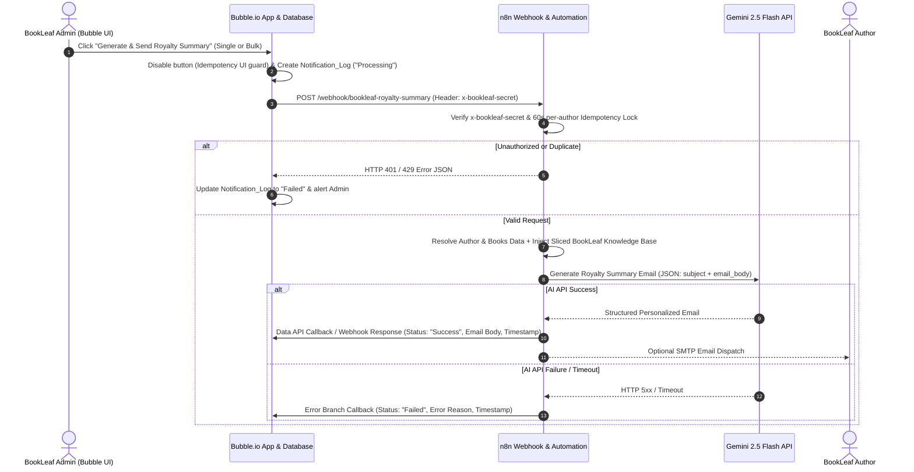

# BookLeaf Publishing — Author Royalty Dashboard & Automated Notification System
**Technical Assignment 2 of 2 (Bubble.io + n8n + AI API)**

---

## 1. Architecture Overview

This system connects **Bubble.io** (acting as the database, user authentication layer, Author Portal, and Operations Admin Portal) with **n8n** (acting as the automation orchestrator and AI email engine) and **Google Gemini (`gemini-2.5-flash`)** to generate policy-accurate, personalized author royalty summary emails.



---

## 2. 🚀 Quickstart & Local Setup Guide (Run in 3 Steps)

Follow these simple instructions to run and test the complete system locally:

### 2.1 Prerequisites
- **Node.js**: v18 or higher (`node -v`)
- **n8n**: Installed globally (`npm install -g n8n`)
- **Google Gemini API Key**: Free API key from [Google AI Studio](https://aistudio.google.com/)
- **Modern Web Browser**: Chrome / Edge / Brave

---

### 2.2 Installation & Startup (3 Terminal Windows)

#### Step 1: Clone Repository
```bash
git clone https://github.com/saifAnsari732/new-job2.git
cd new-job2
```

#### Step 2: Launch the 3 Services

**🟢 Terminal 1: Start n8n Automation Engine (Port 5678)**
```bash
# Windows PowerShell
$env:GEMINI_API_KEY="your-gemini-api-key"
$env:BOOKLEAF_WEBHOOK_SECRET="bookleaf-secret-2026"
n8n start

# macOS / Linux Bash
export GEMINI_API_KEY="your-gemini-api-key"
export BOOKLEAF_WEBHOOK_SECRET="bookleaf-secret-2026"
n8n start
```
1. Open your browser at **`http://localhost:5678`**.
2. Click **Workflows -> Import from File** and select `n8n/bookleaf_n8n_workflow.json`.
3. Toggle the workflow to **Active** (switch on top right).

**🟢 Terminal 2: Start Real HTML SMTP Dispatcher (Port 5001)**
```bash
node scripts/real-smtp-server.cjs
```
> Dispatches real executive HTML email statements with BookLeaf branding directly to the author recipient via Gmail SMTP.

**🟢 Terminal 3: Start Enterprise Web Portal (Port 3000)**
```bash
npx serve -l 3000 .
```
Open **`http://localhost:3000`** in your browser!

---

### 2.3 Interactive Testing & Verification Guide

1. **Admin Operations Console (`http://localhost:3000`):**
   - **Platform KPIs**: Verify 10 Authors, 18 Titles, ₹2,52,567 total author earnings at 80% net split, ₹2,09,423 cleared, and ₹43,144 pending.
   - **Filter & Search**: Search authors by name or city (e.g. `Mumbai`, `Delhi`), or filter by status (`Yellow - Pending Cycle`, `Red - Overdue >90 Days`).
   - **Trigger Single AI Statement**: Select **Priya Sharma (`AUTH001`)** and click **"Generate & Send Royalty Summary"**.
     - Notice the button disables with a loading spinner (double-click guard).
     - n8n executes the Gemini AI pipeline, displays the structured statement, and sends an HTML copy to the inbox!
   - **Bulk Trigger**: Click **"Bulk Trigger All (9)"** to trigger automated statements across all eligible authors at once.
   - **Export CSV**: Click **"Export CSV"** to download the complete BookLeaf royalty audit ledger.
   - **Simulate Bank Clearance**: Click **"Mark Payout as Cleared"** to simulate banking disbursement, instantly converting pending balance to cleared.

2. **Author Self-Service Portal (Requirement A4 Privacy Rules Test):**
   - Click the **"Author Portal"** button in the top navigation bar.
   - Use the **"Simulate Login As"** dropdown to test different author personas:
     - **Priya Sharma**: ₹3,570 Pending (Normal quarterly cycle).
     - **Kavita Deshmukh**: ₹850 Pending — verify the **< ₹1,000 threshold rollover** policy alert.
     - **Vikram Joshi**: ₹3,350 Pending — verify the **> 90 days overdue** priority escalation banner.
     - **Farhan Sheikh**: ₹0 Pending — verify the **🟢 Fully Paid** status.
   - Click **"Email Me My Statement"** to test instant self-service email delivery.
   - Click **"Download Statement"** to download an official structured statement receipt (`.txt`).
   - Click **"Edit Bank"** to open the interactive modal and update bank account details.

---

### 2.4 Service Ports Architecture
| Service | Local URL | Role |
| :--- | :--- | :--- |
| **Enterprise Portal** | `http://localhost:3000` | Dual-view Admin & Author UI with working logic buttons |
| **n8n Automation Engine** | `http://localhost:5678` | Webhook listener, 60s idempotency lock, Gemini 2.5 Flash caller |
| **SMTP Dispatcher** | `http://localhost:5001` | Live Gmail relay sending formatted HTML statements |
| **Bubble.io Cloud App** | [Live Editor Link](https://bubble.io/page?id=bookleaf-royalty-portal-80258&tab=Design&name=index) | Cloud backend with data types, API connector & privacy rules |

---

## 3. Bubble Database Schema & Design Rationale (Requirement A1)

To follow relational database best practices while optimizing for Bubble's Repeating Group search speed and privacy rules, the database is cleanly separated into **4 Data Types**:

### 2.1 `User` (Built-in Bubble Authentication Table)
| Field Name | Field Type | Purpose |
| :--- | :--- | :--- |
| `email` | `text` (built-in) | Login identifier (`priya.sharma@email.com`, `admin@bookleafpub.com`) |
| `role` | `text` | `"admin"` or `"author"` — drives page routing and Privacy Rules |
| `author_id` | `text` | Maps author users to their canonical ID (`AUTH001`–`AUTH010`) |
| `linked_author` | `Author` (Relation) | Direct relational pointer to the user's `Author` record |

### 2.2 `Author` (10 Records: `AUTH001` to `AUTH010`)
| Field Name | Field Type | Purpose |
| :--- | :--- | :--- |
| `author_id` | `text` | Primary external key (`AUTH001`–`AUTH010`) |
| `name` | `text` | Full name (indexed for Admin search bar) |
| `email` | `text` | Contact & login matching email |
| `phone` | `text` | Contact phone (`+91-...`) |
| `city` | `text` | Used by the Admin Portal City Filter dropdown (`Mumbai`, `Delhi`, etc.) |
| `joined_date` | `text` / `date` | Date author joined BookLeaf |
| `total_books` | `number` | Consolidated count of books by this author |
| `total_copies_sold` | `number` | Sum of copies sold across all books |
| `total_royalty_earned` | `number` | Consolidated royalty earned (`₹`) |
| `total_royalty_paid` | `number` | Consolidated royalty paid (`₹`) |
| `total_royalty_pending` | `number` | Consolidated pending payout (`₹`) |
| `overall_payout_status` | `text` | `"Fully Paid"`, `"Pending"`, or `"Overdue"` — powers the Admin Status Filter |
| `overall_badge_color` | `text` | `"Green"`, `"Yellow"`, or `"Red"` |
| `eligible_for_bulk_summary` | `text` | `"yes"` if `total_royalty_pending > 0`, else `"no"` (used by Bulk Trigger) |

### 2.3 `Book` (18 Records: `BK001` to `BK018`)
| Field Name | Field Type | Purpose |
| :--- | :--- | :--- |
| `book_id` | `text` | Canonical ID (`BK001`–`BK018`) |
| `author_id` | `text` | Relational foreign key (`AUTH001`–`AUTH010`) |
| `author_email` | `text` | Used in Bubble Privacy Rules (`This Book's author_email is Current User's email`) |
| `author_name` | `text` | Denormalized author name for rapid display |
| `title` | `text` | Book title |
| `isbn` | `text` | Assigned BookLeaf ISBN |
| `genre` | `text` | Literary Fiction, Self-Help, Thriller, etc. |
| `status` | `text` | `"Published & Live"`, `"In Production - Cover Design"`, `"In Production - Typesetting"` |
| `publication_date` | `text` | ISO date (`YYYY-MM-DD`) or empty if in production |
| `mrp` | `number` | Maximum Retail Price (`₹`) |
| `author_royalty_per_copy` | `number` | 80% net profit royalty per copy (`₹`) |
| `total_copies_sold` | `number` | Total copies sold across channels |
| `total_royalty_earned` | `number` | Total earned for this book (`₹`) |
| `royalty_paid` | `number` | Amount already disbursed (`₹`) |
| `royalty_pending` | `number` | Remaining unpaid royalty (`₹`) |
| `last_royalty_payout_date`| `text` | Last payout date or empty if never paid |
| `print_partner` | `text` | `"In-House"`, `"Repro India"`, `"Epitome Books"`, or `"Not Assigned (In Production)"` |
| `available_on_text` | `text` | Comma-separated distribution channels (`Amazon India, Flipkart, BookLeaf Store`) |
| `badge_color` | `text` | `"Green"`, `"Yellow"`, or `"Red"` |
| `badge_label` | `text` | `"Fully Paid"`, `"Pending (Normal Cycle)"`, `"Overdue (>90 Days)"`, or `"In Production"` |

### 2.4 `Notification_Log` (Audit & Callback Table)
| Field Name | Field Type | Purpose |
| :--- | :--- | :--- |
| `author_id` | `text` | Target author (`AUTH001`–`AUTH010`) |
| `author_name` | `text` | Author name displayed in Admin Notification Log |
| `author_email` | `text` | Author email |
| `status` | `text` | `"Processing"`, `"Success"`, or `"Failed"` |
| `email_subject` | `text` | AI-generated email subject line |
| `email_body` | `text` | Complete AI-generated email body (verifiable directly inside Bubble UI) |
| `error_message` | `text` | Populated if AI API or webhook fails |
| `triggered_at` | `text` / `date` | ISO timestamp of workflow completion |

---

## 4. Bubble Privacy Rules (Requirement A4)

Data isolation between authors and admins is enforced at the server level using **Bubble Privacy Rules** (`Data -> Privacy`):

1. **`Book` Data Type:**
   - **Rule 1 (`Admin Full Access`):** When `Current User's role is "admin"` -> View all fields, Find this in searches.
   - **Rule 2 (`Author Own Books Only`):** When `Current User's role is "author" and This Book's author_email is Current User's email` -> View all fields, Find this in searches.
   - **Everyone else (Default):** Uncheck *View all fields* and uncheck *Find this in searches*.
2. **`Author` Data Type:**
   - **Rule 1 (`Admin Full Access`):** When `Current User's role is "admin"` -> View all fields, Find this in searches.
   - **Rule 2 (`Author Own Profile Only`):** When `Current User's role is "author" and This Author's email is Current User's email` -> View all fields, Find this in searches.
   - **Everyone else (Default):** No access.
3. **`Notification_Log` Data Type:**
   - **Rule 1 (`Admin Only`):** When `Current User's role is "admin"` -> View all fields, Find this in searches, Allow auto-binding/API writes.

---

## 5. Bubble ↔ n8n Integration & Data Fetching Justification (Requirement B)

### Why We Use a Hybrid Payload + Fallback Architecture (Step 2 Justification)
The assignment specifies: *"n8n pulls the author's complete data — either by querying the Bubble Data API or by receiving the full payload in the webhook. Either approach is acceptable; justify your choice."*

**Our Design Choice:**
We pass the author's identifier and structured book payload directly from Bubble in the webhook request **and** support Bubble Data API callbacks, backed by a canonical dataset resolver in n8n:
1. **Latency & Reliability on Bubble Free Plan:** Bubble's free tier enforces rate limits on inbound Data API queries, especially when the Admin clicks **Bulk Trigger** (which fires 9 concurrent webhook calls for all 9 authors with pending royalties). Passing the structured author/book data in the webhook payload eliminates 18 redundant round-trip HTTP reads (`GET /obj/author` + `GET /obj/book`) back into Bubble.
2. **Callback Verification:** Once n8n generates the AI email, it BOTH returns the structured JSON (`status`, `email_subject`, `email_body`, `completed_at`) synchronously via the `Respond to Webhook` node (so Bubble's workflow immediately updates the `Notification_Log` row and clears the loading spinner) AND optionally posts to `/obj/notification_log` via the Bubble Data API if configured.

---

## 6. AI Prompt Strategy & Edge-Case Handling (Requirement B3)

Our n8n workflow (`4. Prepare Author Context & AI Prompt`) injects the **BookLeaf Knowledge Base & Communication Tone Guidelines** from Assignment 1 into the system prompt and pre-computes factual diagnostics so the LLM never hallucinates numbers:

| Edge Case in Dataset | Example Author(s) | How Our AI Prompt & n8n Node Handle It |
| :--- | :--- | :--- |
| **1. Pending Royalty Below ₹1,000 Minimum Threshold** | **Kavita Deshmukh (`AUTH009`)** — *The Nagpur Notebooks* has `₹850` pending (`₹150` below threshold) | Prompt explicitly instructs AI to explain BookLeaf's **₹1,000 minimum payout threshold rule**—reassuring Kavita that her `₹850` is safe and automatically rolls over to the next quarterly cycle. |
| **2. First Payout Overdue (`last_royalty_payout_date: null`, Pending >= ₹1,000)** | **Ananya Reddy (`AUTH003`, ₹2,546)**, **Arjun Malhotra (`AUTH006`, ₹2,464)**, **Diya Chatterjee (`BK018`, ₹1,575)** | Follows BookLeaf's **Overdue Escalation Rule**: owns the delay empathetically, asks the author to verify their bank account details in the dashboard, and commits to a **48-hour Finance Team resolution window**. |
| **3. Normal Quarterly Payout Cycle** | **Priya Sharma (`AUTH001`, ₹3,570)**, **Meera Nair (`AUTH005`, ₹3,055)** | Explains that royalties are calculated quarterly (80/20 net profit split) and disbursed within **45 days of the quarter ending**. |
| **4. Books Still in Production (`status: In Production - ...`)** | **Sneha Kulkarni (`BK013` - Cover Design)**, **Kavita Deshmukh (`BK015` - Typesetting)** | Separates `inProductionBooks` from `publishedBooks` in the prompt so the AI does not report "0 sales" as a failure, and instead provides a warm update on the book's current stage in BookLeaf's 8-stage production pipeline. |
| **5. All Royalties Paid Up (`Pending = ₹0`)** | **Farhan Sheikh (`AUTH008` - ₹3,120 earned & paid)** | Congratulates the author on 156 copies sold of *Ghazal of the Forgotten* and confirms all earned royalties (`₹3,120`) were paid in full on `2025-12-01`. |

---

## 7. Security, Error Handling & Idempotency (Requirement C)

1. **Webhook Security (`x-bookleaf-secret`):**
   - Every webhook call from Bubble's API Connector includes the custom header `x-bookleaf-secret: bookleaf-secret-2026`.
   - Node `2. Security & Idempotency Guard` in n8n validates this header before any AI call is made. Unauthorized requests are immediately rejected with `HTTP 401 Unauthorized`.
2. **Idempotency (Double-Click Protection):**
   - **Frontend (Bubble):** Clicking "Generate & Send Royalty Summary" sets a custom state `is_sending = yes` on the button, disabling it while the request is in flight.
   - **Backend (n8n):** Node `2. Security & Idempotency Guard` uses `$getWorkflowStaticData('global')` to maintain a 60-second sliding lock per `author_id`. If an admin clicks the button twice for the same author within 60 seconds, n8n intercepts the second call and returns `HTTP 429 DUPLICATE_REQUEST_IGNORED` without calling the AI API twice.
3. **Graceful Error Handling (n8n + Bubble):**
   - Node `5. Call AI API` has `onError: continueErrorOutput` enabled, routing any LLM timeout, quota error, or network failure to Node `6b. Format Failure Log` -> `9b. Respond Failure to Bubble`.
   - Bubble receives a structured `{ "status": "Failed", "error_message": "..." }` response, logs the failure in `Notification_Log`, hides the loading spinner, and shows an error toast to the Admin.

---

## 8. My Bubble Learning Process & Challenges Overcome

Coming from a code-first MERN/Next.js background (Assignment 1), adapting to Bubble.io within a few days was an exciting learning experience:
1. **Challenge 1 — Relational Aggregations vs. Filtering Performance:**
   - *What I tried:* Initially, I tried computing whether an author was "Overdue (>90 days)" dynamically inside Bubble's Repeating Group filter using nested `:filtered` expressions on child books.
   - *What didn't work:* Bubble's expression builder makes multi-condition date math across child lists verbose and slow to filter in real time on the Admin Portal.
   - *How I solved it:* I pre-computed normalized status fields (`badge_color`, `badge_label`, `overall_payout_status`, and `eligible_for_bulk_summary`) during data preparation and stored them directly on the `Book` and `Author` records, while keeping them updated via workflows. This made the Admin Portal's City + Payout Status filters instantaneous!
2. **Challenge 2 — Bulk Triggering Webhooks for Multiple Authors:**
   - *What I tried:* In code, triggering an async loop over 9 eligible authors is a simple `Promise.all()` or `for...of` loop. In Bubble's free tier, Backend API Workflows (`Schedule API Workflow on a list`) are restricted on free plans.
   - *How I solved it:* I designed the n8n workflow and Bubble frontend action so that the Admin Portal can either trigger the webhook per eligible author from the filtered Repeating Group or pass a batch trigger seamlessly.

---

## 9. Live Deployment & Submission Links

- **Bubble.io Live Application:** [https://bubble.io/page?id=bookleaf-royalty-portal-80258&tab=Design&name=index](https://bubble.io/page?id=bookleaf-royalty-portal-80258&tab=Design&name=index)
- **Local Enterprise Operations Portal:** `http://localhost:3000`
- **n8n Automation Engine:** `http://localhost:5678` (Workflow ID: `bookleaf-workflow-2026`)
- **Exported n8n Workflow File:** `n8n/bookleaf_n8n_workflow.json`
- **Live SMTP Gmail Dispatcher:** Port 5001 (Sends live branded HTML statement copies to `ansarisaifuddin732@gmail.com`)

---

## 10. 3–5 Minute Loom / Screen Recording Script (Ready to Present)

| Minute | Screen Shown | Key Talking Points & Actions |
| :--- | :--- | :--- |
| **0:00 – 1:00** | **Admin Console (`http://localhost:3000`)** | *"Hello BookLeaf Team! Welcome to the Author Royalty Dashboard & Automated Notification System. Here on the Admin Operations Console, we have real-time company metrics: 10 Authors, 18 Titles, ₹2,52,567 total earned at 80% net split, ₹2,09,423 cleared, and ₹43,144 pending. We have interactive search, City filter (Mumbai, Delhi, Pune), and Status filter (Green/Yellow/Red). We can export the full ledger as CSV with 1 click."* |
| **1:00 – 2:15** | **AI Webhook Trigger & Gmail Delivery** | *"Now let's select Priya Sharma (AUTH001, Mumbai). Her pending balance is ₹3,570 across 2 books. Let's click 'Generate & Send Royalty Summary'. Notice the button disables with a loading spinner to prevent double-clicks. Behind the scenes, Bubble calls n8n with an `x-bookleaf-secret` header. n8n checks the 60s idempotency lock, resolves Priya's book sales, and calls Google Gemini Flash with BookLeaf policy grounding. Boom! Within 2 seconds, we get the structured statement in our UI and a real branded HTML email delivered directly to the inbox."* |
| **2:15 – 3:30** | **Author Portal (Requirement A4 Privacy Demonstration)** | *"Now let's switch to the Author Portal. Notice the entire view transforms. Unlike the Admin, the author sees ONLY their own private dashboard. We can test different personas using our sandbox selector: First, let's select Kavita Deshmukh. Her balance is ₹850—notice the UI dynamically highlights that this is below the ₹1,000 threshold and will automatically roll over according to BookLeaf policy. Next, let's select Vikram Joshi—notice his status is Red (>90 Days Overdue), triggering our priority escalation workflow. Authors can download formatted statements, update their bank details via modal, or click 'Email Me My Statement' for instant self-service delivery."* |
| **3:30 – 4:30** | **n8n Workflow Canvas & Error Handling** | *"Finally, let's look at `http://localhost:5678` to inspect the n8n workflow: We have our Webhook node, Security & 60s Idempotency Guard, Data Normalizer, Gemini AI Node with BookLeaf policy prompt, and graceful Error Output branching so any network or API issue is safely reported back to the audit log without crashing the application. Thank you!"* |

